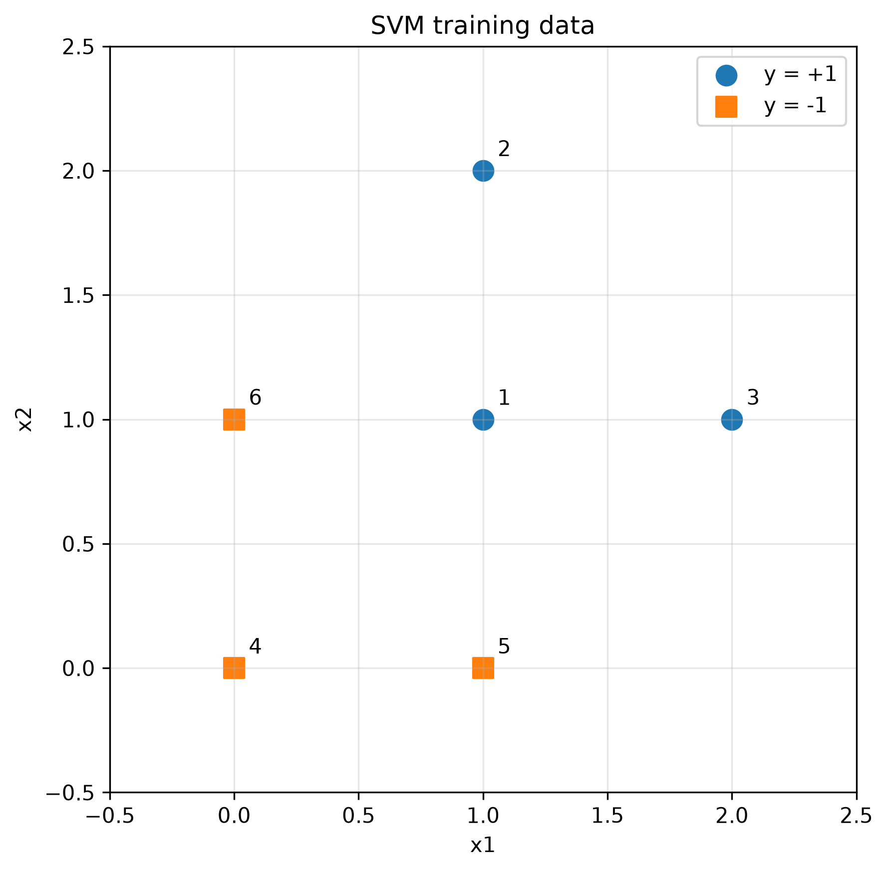

# CSE 242 — Assignment 3: SVMs, K-means, and K-NN

## Question 1: Hard-margin linear SVM — 30 points

Use the following two-feature training set:

| Point ID | x1 | x2 | y |
| --- | --- | --- | --- |
| 1 | 1 | 1 | +1 |
| 2 | 1 | 2 | +1 |
| 3 | 2 | 1 | +1 |
| 4 | 0 | 0 | -1 |
| 5 | 1 | 0 | -1 |
| 6 | 0 | 1 | -1 |

**(a) Plot and support vectors — 10 points.** Plot the data by hand or with Python and identify all support vectors by eye. Explain your selection. The plotting helper in `assignment3_template.py` labels the points for you. 

The figure plotted from the python program: 


The support vectors are: 
| Point ID | x1 | x2 |
| --- | --- | --- |
| 1 | 1 | 1 | 
| 5 | 1 | 0 | 
| 6 | 0 | 1 | 

**Justification**: This is a 2-dimensional figure. We can place two parallel lines: one through point 5 and 6, and the other through point 1. The parallel lines form the widest possible gap area between the two groups. Those three points 1, 5, and 6 are on the edges of this gap, so they are support vectors. 


**(b) Boundary and margin — 20 points.** Using the support vectors, derive the maximum-margin separating line **w1 x1 + w2 x2 + b = 0** (10 points), then calculate the geometric margin (10 points). Include the intercept b. Assume a linear, hard-margin SVM with no slack variables. Report the margin as the distance from the decision boundary to the closest training points; if you also report the full width between supporting boundaries, label it separately. 

The support vectors satisfy $w_1x_1 + w_2x_2 + b = y$. Substitute points 1, 5, and 6 into the formula: 
$$w_1 + w_2 + b = 1$$
$$w_1 + b = -1$$
$$w_2 + b = -1$$
Solution: $w_1 = w_2 = 2, b=-3$.

The maximum-margin separating line is $2 x_1 + 2 x_2 - 3 = 0$. This separating line makes support vectors get the classification $+1/-1$. 

The geometric margin is $\frac{1}{||w||} = \frac{1}{2\sqrt{2}} = 0.3536$. 


## Question 2: K-means — 30 points

**(a) Implement the update steps — 15 points.** In `kmeans_template.py`, complete `update_assignments()` and `update_centroids()` from scratch. NumPy operations are allowed; do not substitute a library K-means implementation. The outer loop is provided. Document how you resolve distance ties and handle empty clusters. 

- The program simply chooses the first centroid with minimum distance when distance ties. `np.argmin` implements this rule by default. 
- For the empty clusters, the program retains the previous centroid.
Check the python file for the implementations. 

**(b) Run and plot — 15 points.** Generate the provided toy dataset:

```python
make_blobs(n_samples=4000, centers=4, cluster_std=0.60, random_state=0)
```

Run your implementation for **k = 2, 3, 4, 6, 10**. Save a plot of the cluster assignments and final centroids for each value. In a short paragraph, explain what changes as k increases and how the results relate to the four generating groups.


**Discussion:** As k increases, k-means finds more clusters. When k is less than 4, a large amount of data with different labels are grouped in one cluster. When k is greater than 4, some data with the same label can be grouped into different clusters. Even when k=4, we can observe some data located at the overlapping area can be grouped into other clusters.


## Question 3: Noisy-label SVM and K-NN repair — 40 points

Work in `noisy_classification_template.py`. Helpers for generating clean data and training/evaluating the SVM are provided.

Generate independent training and test sets. Each set contains:

- 1,000 positive examples from a Gaussian with mean **(1, 1)** and covariance **I**.
- 1,000 negative examples from a Gaussian with mean **(-1, -1)** and covariance **3I**.

Keep the test labels clean throughout.

**(a) Noisy-label baseline — 20 points.** Complete `corrupt_training_labels()` and the baseline portion of `run_comparison()`. Independently flip each original positive training label with probability **0.35**, and each original negative training label with probability **0.20**. Apply the probabilities to the original labels so that an example cannot be flipped twice. Train an RBF SVM with **C = 1** and **gamma = 0.01**.

Keep the generated training and test sets fixed, repeat label corruption and training **20 times**, and report the mean accuracy on the clean test set. Use a seed for reproducibility.

**(b) K-NN label repair — 20 points.** Complete `repair_labels_knn()` and the comparison portion of `run_comparison()`. For each training point:

1. Find its **five nearest other training points** using Euclidean distance.
2. Replace its label with the majority of those neighbors' noisy labels.
3. Compute every repaired label from the same original noisy-label array, rather than modifying labels sequentially.

A neighbor-search library is allowed. Five binary votes cannot tie; use a consistent rule if distances tie when selecting neighbors. Train a fresh SVM with the same parameters on the repaired labels. For each trial, use the same features and corrupted labels as the baseline.

Save a CSV with one row per trial and columns `trial`, `baseline_accuracy`, and `knn_accuracy`. Report both mean accuracies and their difference. Briefly explain whether K-NN repair helped and why it might help or hurt. Improvement is not guaranteed. No parameter sweep or additional clustering-based repair experiment is required.

**Summary:** In our experiments, `baseline_accuracy` is 82.19% and `knn_accuracy` is 85.79% on average, which achieves 3.59% improvement on the accuracy. K-NN repair assumes that the nearby data points are more likely have the same label. When a noisy-labelled data point is surrounded by the points with the label it should be, KNN can correct the noise and improve the classification. However, it is also possible that KNN changes a crrectly labelled point only because it is close to the boundary of the groups. In such scenario, KNN repair worsen SVM classification. 

## References and AI Assistance
1. https://scikit-learn.org/stable/modules/generated/sklearn.svm.SVC.html#sklearn.svm.SVC 
2. https://numpy.org/doc/stable/reference/random/generator.html
3. https://chatgpt.com/share/6aee36e7-06cc-83e8-af74-7752e7c52472

AI-based code completion is used in this assignment. 
