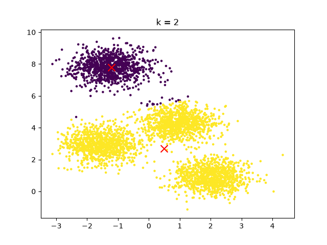
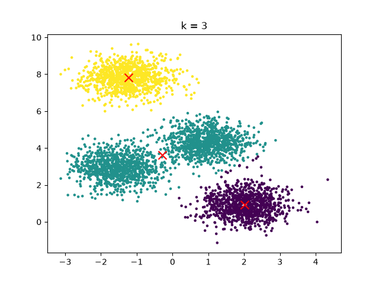
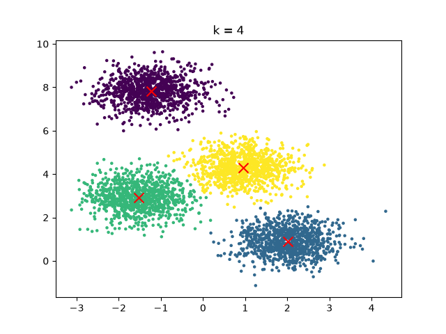
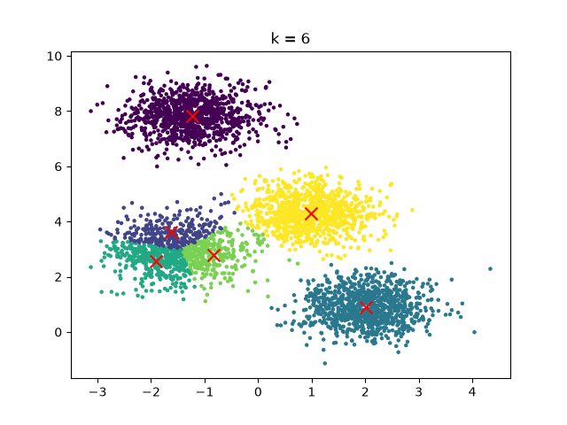
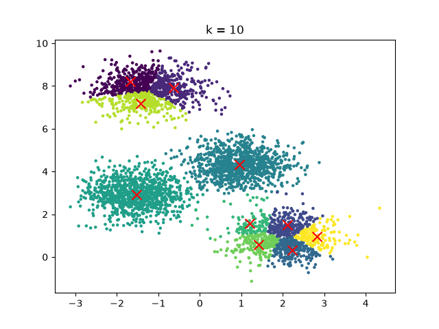

# svm derivation and margin

# x = [1,5,6]

equations
calculate w, b

w_1*x[1]_1 + w_2*x[1]_2 + b = 1
w_1*x[5]_1 + w_2*x[5]_2 + b = -1
w_1*x[6]_1 + w_2*x[6]_2 + b = -1

w_1*1 + w_2*1 + b = 1
w_1*1 + w_2*0 + b = -1
w_1*0 + w_2*1 + b = -1

w_1 + w_2 + b = 1
w_1 + b = -1
w_2 + b = -1

b = -w_1-w_2+1
w_1 = -1-b
w_2 = -1-b

b = -(-1-b)-(-1-b)+1
b = -(-2-2b)+1
b = 2+2b+1
b = -3

b = -3
w_1 = -2
w_2 = -2

# k-means plots and discussion







As k increases, the cluster means start to define the 4 groups, after 4 clusters, the clusters start getting overfit, splitting a group into multiple different clusters

# two method accuracy comparison

```
Mean baseline accuracy:      0.8279500000000001
Mean K-NN repaired accuracy: 0.8644000000000001
Change from baseline:        0.03644999999999998
```

# experiment csv

[csv file](noise_comparison.csv)